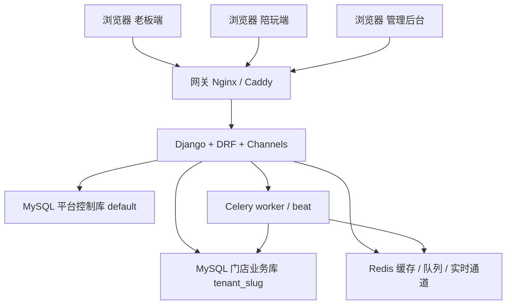

# XA 电竞陪玩运营平台

面向电竞陪玩门店的多租户 SaaS 运营平台，连接老板下单、陪玩履约和后台管理，覆盖从订单创建、派单履约到售后、结算与提现的业务全流程。

**首版开发中** · 三端 Web · 一店一业务库 + 平台控制库 · 模块化单体

[产品与业务](#产品与业务) · [架构](#架构) · [工程组织](#工程组织) · [开始开发](#开始开发) · [项目目录](#项目目录) · [测试与验收](#测试与验收) · [部署与外部接入](#部署与外部接入) · [文档](#文档) · [许可](#许可)

> 本项目仍在首版开发和联调阶段。下文介绍产品范围与工程结构，不表示全部功能、外部渠道或生产部署已经完成验收；当前进度以[研发记录](docs/development/16-开发进度.md)与[功能开发工作总览](docs/development/30-功能开发工作总览.md)为准。

## 产品与业务

| 端 | 使用者 | 主要业务 |
| --- | --- | --- |
| 老板端 | 门店客户 | 浏览服务与陪玩、预约和下单、订单跟进、评价、钱包及会员权益 |
| 陪玩端 | 门店陪玩 | 绑定与资料、抢单、试音、履约与报单、收益、押金及提现 |
| 管理后台 | 平台和门店职能人员 | 门店与授权、订单调度、客服售后、资金审核、运营配置及经营核算 |

系统按门店管理订单、客户、钱包、运营和员工数据。平台超级管理员按授权管理门店目录、域名与 License 并做跨店汇总；门店人员只访问其所属门店。提现由门店客服初审、平台财务终审并登记线下打款。

业务硬约束：金额用整数内部单位（10 内部单位 = 1 店币，人民币 1 元 = 10 店币），薪资用人民币分；原价、成交、实付、积分抵扣、已退与补贴分开保存；资金计算禁用浮点，付款由服务端在锁内重算，相同 `client_request_id` 按原回执恢复。

## 架构

技术决策是**保持现有栈、治理单体**，不拆微服务、不换数据库体系：

- **前端**：老板端、陪玩端、管理后台三个独立 React + TypeScript + Vite 应用，Tailwind CSS 4 与 shadcn；微信授权走公众号网页授权。
- **后端**：Django + DRF + Channels + Celery 的模块化单体，17 个平铺领域 app；ASGI（Daphne）同时承载 HTTP 与 WebSocket。
- **数据**：MySQL 平台控制库（`default`）+ 各门店独立业务库（`tenant_<slug>`）；Redis 承担缓存、Celery broker/结果、Channels 实时通道四类职责。
- **多租户**：`stores/middleware.py` 在认证前解析门店上下文，`stores/router.py` + `stores/context.py` 决定每次数据库访问的别名；接口、令牌、缓存、文件、WebSocket 与异步任务都必须携带门店上下文。
- **部署**：本机开发用 PowerShell + WSL2 + Docker Compose + Nginx；发布用 Compose + Caddy。



### 分层与依赖方向

| 层次 | 职责 | 位置 |
| --- | --- | --- |
| 表示层 | 三端界面与共享 UI 逻辑 | `fronted/{boss,provider,admin,shared}` |
| API 接入层 | DRF View、WS Consumer、认证中间件 | 各 app views、`orders/consumers.py`、`club_accounts/channels_middleware.py` |
| 领域服务层 | 订单、钱包、聊天、授权、平台操作编排 | `orders/`、`wallet/`、`chat/`、`stores/` 等服务模块 |
| 领域模型层 | Model、序列化器、迁移 | 各 app `models/`、`migrations/` |
| 公共基础设施 | 日志、媒体、限流、健康检查、合规 | `common/`、`packages/money` |
| 多租户基础层 | 路由、上下文、动态连接、License | `stores/` |

目标依赖方向为「后台只编排 → 领域服务 → 模型/金额内核」，业务模块不得 import `console`。**现状仍有差距**：`orders` 与 `wallet` 相互 import、`console` 承载过多业务编排、金额内核尚在规划，均已列入[重构计划](docs/architecture/REFACTORING_PLAN.md)，不应误读为已完成。

### 多租户隔离要点

- 非 `stores` 模型走当前租户库；`stores` 自身永远回到 `default` 控制库。
- 启用 `ISOLATED_CONTROL_PLANE` 后，从默认库读写门店 app 会抛错；`allow_migrate` 阻止在门店库迁移控制面 app。
- 禁止跨库对象关联与跨店比较；控制库不得复用为门店别名。
- 控制库故障时按受控路由快照降级，快照只是兜底，不构成完整离线授权承诺。

## 工程组织

单仓多工作区，三套依赖并行、互不混装：

| 范围 | 工具 | 说明 |
| --- | --- | --- |
| 根目录 | pnpm 9.0.0 | 只管理 `packages/money` 与根工具脚本（含 Playwright 依赖） |
| `fronted/` | npm workspaces + 独立 lock | 三端与共享模块，独立演进与构建 |
| `services/backend/` | Python 3.13+ 虚拟环境 + pip | Django 及业务依赖 |

前端包名：`@xa/fronted-boss`、`@xa/fronted-provider`、`@xa/fronted-admin`、`@xa/fronted-shared`。共享逻辑（会话、门店上下文、客户端、主题）集中在 `fronted/shared/src/`。

## 开始开发

### 环境要求

| 工具或资源 | 要求 |
| --- | --- |
| 操作系统 | Windows、PowerShell 7、已配置的 WSL2 与 Docker Engine |
| Node.js | 22.12 或更高版本 |
| 包管理器 | 根目录 pnpm 9.0.0；`fronted/` 使用 npm |
| Python | 3.13 或更高版本，项目独立虚拟环境 |
| 数据服务 | 项目登记的隔离 MySQL 与 Redis 开发资源 |

首次准备前阅读 [deploy/README.md](deploy/README.md)。标准开发脚本复用已登记的隔离数据库，不自动清空或重建业务数据。[`.env.example`](.env.example) 与 [`deploy/esports-local/.env.example`](deploy/esports-local/.env.example) 是配置模板；真实密钥由授权维护者单独配置，不入库。

### 安装与启动

```powershell
pnpm install --frozen-lockfile
npm --prefix fronted ci

./deploy/dev.ps1 Up
./deploy/dev.ps1 Status
./deploy/dev.ps1 Verify
```

| 操作 | 命令 |
| --- | --- |
| 后端修改后重启 | `./deploy/dev.ps1 RestartBackend` |
| 修改代理配置后重载 | `./deploy/dev.ps1 Reload` |
| 查看日志 | `./deploy/dev.ps1 Logs` |
| 停止本项目开发服务 | `./deploy/dev.ps1 Down` |

`Down` 保留登记的数据库、Redis 和依赖卷。禁止另起未登记的 Vite、Django 或代理服务替代登记入口。

### 本机入口

| 门店 | 老板端 | 陪玩端 |
| --- | --- | --- |
| 声浪电竞 | [sl.esports.club/boss/](http://sl.esports.club/boss/) | [sl.esports.club/player/](http://sl.esports.club/player/) |
| 兴安电竞 | [xa.esports.club/boss/](http://xa.esports.club/boss/) | [xa.esports.club/player/](http://xa.esports.club/player/) |

管理后台统一使用 [admin.esports.club](http://admin.esports.club/)，登录前不预选门店，凭据多匹配时须消歧。以上地址用于本机开发，不代表公网服务已发布。

### 工程检查

```powershell
pnpm run verify:frontend   # typecheck + 前端测试 + 三端构建
./.venv/Scripts/python.exe services/backend/manage.py check --settings=config.test_settings
./.venv/Scripts/python.exe services/backend/manage.py makemigrations --check --dry-run --settings=config.migration_test_settings
```

命令适用范围和结果需分别记录。隔离环境检查不能替代真实微信、短信、资金和生产部署验收。

## 项目目录

```text
.
├── fronted/                  三端网页与共享模块（npm workspaces）
│   ├── boss/                 老板端
│   ├── provider/             陪玩端
│   ├── admin/                管理后台
│   ├── shared/               跨端共享模块
│   └── tests/                前端契约与组件测试
├── services/backend/         Django 业务服务、迁移和测试
├── packages/money/           共享金额换算与格式化工具
├── deploy/
│   ├── compose/              容器编排与发布配置
│   ├── esports-local/        本机开发环境与代理
│   ├── images/               前后端镜像构建
│   └── dev.ps1               本机服务统一入口
├── scripts/                  工程检查、隔离联调与验收脚本
├── docs/
│   ├── prd/                  产品需求与决策
│   ├── development/          研发方案、进度与验收追踪
│   ├── architecture/         架构与数据资料
│   ├── ops/                  运维与发布记录
│   └── history/              历史归档（只供追溯）
├── .qoder/skills/            项目级 Agent 技能与用法手册
├── .github/workflows/        CI 与手动发布工作流
├── AGENTS.md                 项目协作与开发约定
└── LICENSE                   项目许可声明
```

旧端脚本及其调用方已逐项核对：无当前调用链的旧脚本和仅依赖旧端的测试已移除；仍与现有业务断言或当前端场景混用的脚本暂时保留，它们依赖已移除的旧端，不能作为当前三端的验收依据。具体处理与剩余调用方见[混合调用复核](docs/ops/records/legacy-script-followup-52-20261115.md)。

## 测试与验收

按风险分层，逐层留证：

| 层 | 入口 | 覆盖 |
| --- | --- | --- |
| 业务规则 | `config.test_settings`（SQLite） | 状态机、权限、幂等、取整 |
| 结构一致 | `config.migration_test_settings` | 模型与迁移一致、空库迁移 |
| 行锁并发 | `config.mysql_test_settings` | 真实 MySQL 行锁与竞争 |
| 双店隔离 | `config.multitenant_mysql_test_settings` | 同数字 ID 跨店隔离 |
| 前端契约 | `scripts/fronted-test-runtime.mjs` + Node 测试运行器 | REST/WS 契约、丢包与重试 |
| 浏览器 | 登记环境实测 | 页面四态、1366×1024、移动端 |

CI（`.github/workflows/ci.yml`）并行跑前端构建与测试、后端检查与测试、MySQL 迁移与并发流程三个 job；发布工作流仅手动触发。MySQL 测试库名须以 `xa_test_` 开头，只允许登记 host；禁止触及生产资金、真实客户与真实消息接收人。

资金、真实渠道与生产就绪的验收由业务负责人认定，统一归 M7；未验项标「待联调」，不把隔离结果写成生产验收。

## 部署与外部接入

生产配置从 [`deploy/compose/`](deploy/compose/README.md) 与环境变量模板开始，支持自带数据库与外部托管数据库两种模式。发布工作流的远程部署仅由手动触发；正式发布前需在目标环境完成数据库迁移、平台与门店初始化、授权配置和业务联调，并按完整 Git SHA 逐店灰度。本仓库中的配置检查不构成上线许可。

微信快捷登录、短信、KOOK 与企微保留真实接入链路，资质或服务商配置未完成时不能视为已接通。本机隔离替身仅用于开发验证，不能用于生产。容量目标（约 160 人持续、50 RPS 峰值 30 分钟）是规划指标，尚待目标环境压测确认。

## 文档

| 文档 | 内容 |
| --- | --- |
| [文档中心](docs/README.md) | 文档体系、格式标准、阅读路径与治理规则 |
| [功能开发工作总览](docs/development/30-功能开发工作总览.md) | 55 项功能台账、完成门禁、待裁定口径与排期索引 |
| [变更日志](CHANGELOG.md) | 全项目变更归纳合并（日期倒序，链接权威记录） |
| [产品需求](docs/prd/README.md) | 三端业务规则和产品决策 |
| [研发方案与进度](docs/development/README.md) | 实施方案、接口契约、工作包和验收追踪 |
| [企业级总体规划](docs/development/26-企业级总体规划.md) | 阶段路线图、验收门禁、生产就绪与治理调整清单 |
| [架构与数据资料](docs/architecture/README.md) | 目录边界、数据模型、目标架构与重构计划 |
| [开发与部署](deploy/README.md) | 本机资源、启动命令和运行边界 |
| [工程脚本](scripts/README.md) | 场景入口、工程检查和脚本使用范围 |
| [技能用法手册](.qoder/skills/README.md) | 海报技能的命令示例与安装说明 |
| [贡献指南](CONTRIBUTING.md) | 项目协作和提交规范 |
| [第三方许可](THIRD_PARTY_NOTICES.md) | 组件、字体和图标的许可及署名 |

仓库另有一份由代码与文档生成的 Repo Wiki（项目概览、系统架构设计、后端服务、前端应用、数据库设计、API 接口文档、测试策略、部署与运维、业务领域指南、开发规范）。Wiki 与本目录文档冲突时，以较新文档和用户最新决定为准。

## 许可

本项目为闭源专有软件，项目原创代码、文档和设计的使用以 [LICENSE](LICENSE) 及相关书面授权为准。第三方组件和素材适用各自的许可与版权声明，详见 [THIRD_PARTY_NOTICES.md](THIRD_PARTY_NOTICES.md)。

Copyright © 2026 青岛声浪传媒有限公司。All rights reserved.