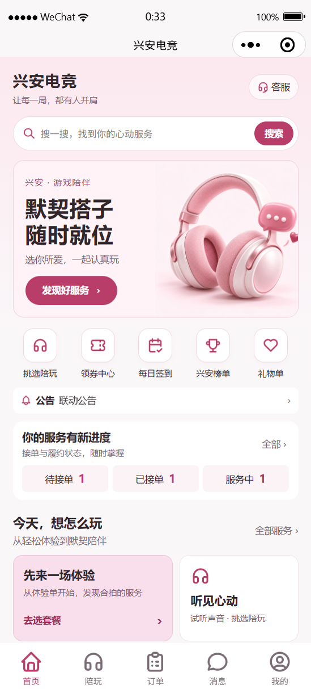
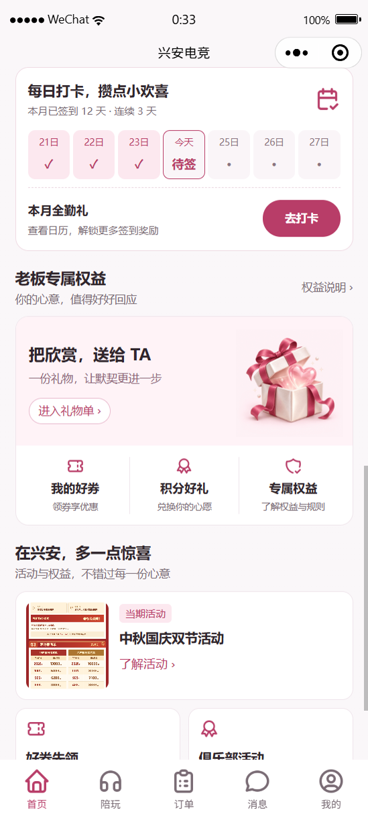
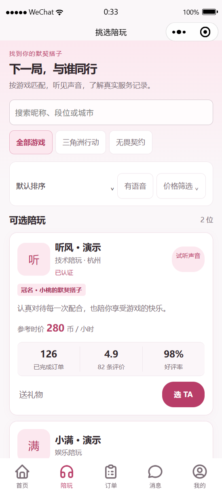
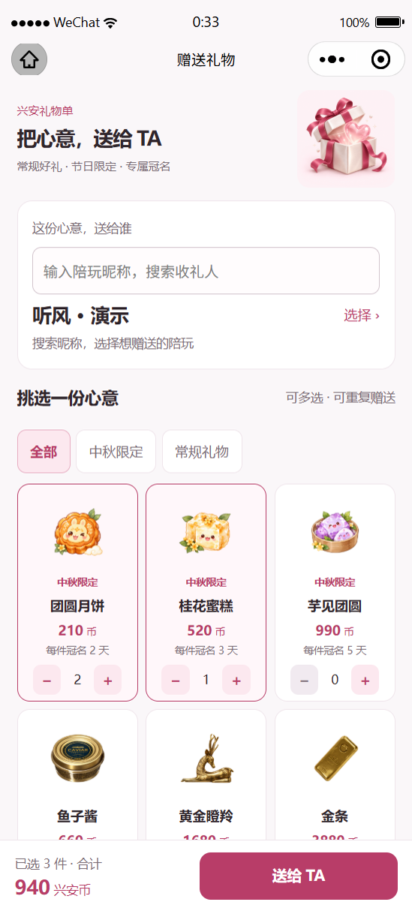
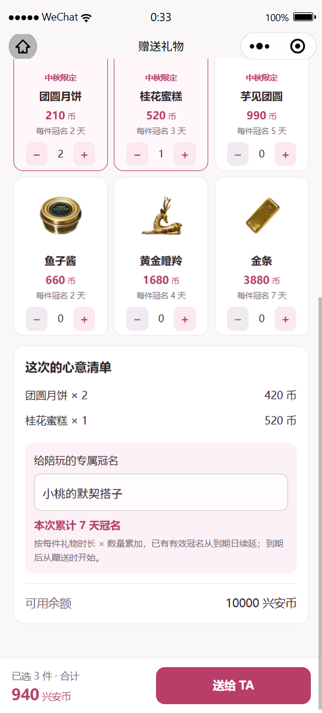
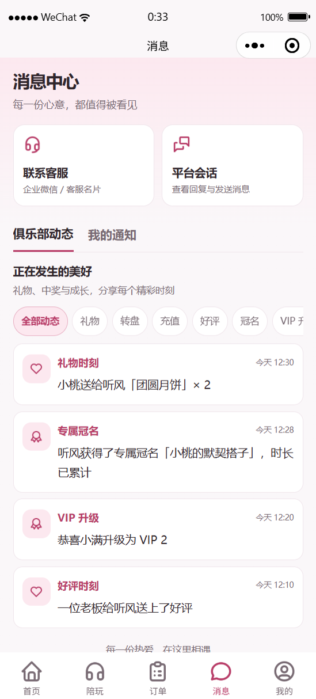

# 老板端小程序改版与赠礼流程

实现位置为 `apps/boss-miniapp/native`，保留微信原生页面、组件和导航。此轮为本地代码交付，未发布到线上。

## 布局与流转

- 底部导航：首页、陪玩、订单、消息、我的。服务商城保留为独立页面，可从首页搜索、玩法和套餐卡片进入。
- 首页：品牌搜索、活动主视觉、五个快捷入口、独立官方公告、订单进度、玩法与服务推荐、七日打卡预览、老板权益与礼物入口。VIP 预存档位在会员中心展示。
- 陪玩：按游戏和昵称筛选，试听声音，查看服务记录、参考时价与有效冠名。价格筛选可展开。不可接单的陪玩仍可展示及收礼，禁止下单；禁用、隐藏或未认证账号不展示。
- 服务详情 → 套餐 → 结算 → 陪玩选择使用独立选择页，保留结算上下文；陪玩列表 → 选择服务保留陪玩筛选。
- “我的”和首页订单进度可以进入对应订单状态；活动横幅支持服务、玩法、运营内容和白名单业务入口。

## 礼物与冠名规则

老板可从首页、我的、陪玩列表直接赠送，也可从已完成的付费服务订单给该单陪玩赠送。

1. 选择指定收礼陪玩；可多选礼物，每款可重复购买。单次最多 30 款，每款最多 999 件。
2. 后台逐款设置节日标记、售卖起止时间、每件冠名天数。节日限定礼物最低 21 元（210 兴安币，账本单位 2100）。
3. **每件直接累计**：每件冠名天数 × 数量，再对本次所有礼物求和。不要求凑齐整套。
4. 用户已确认由后台逐款配置后启用冠名。默认天数为 0，礼物仍可正常赠送；界面不承诺冠名，后端不生成冠名时长。没有擅自给现有礼物填入默认天数。
5. 有冠名时，老板填写 1～30 字单行冠名文字。同一老板对同一陪玩续赠，文字采用此次填写内容，到期时间从 `max(原到期时间, 本次赠送时间)` 累加。不同老板的有效冠名分别展示；过期或后台隐藏的冠名不展示。
6. 一次确认，多款礼物统一事务提交；每款生成一笔礼物单。价格变化、余额不足、礼物过期、收礼人不可用或任一款校验失败，全部回滚。
7. 请求去重、账本流水与冠名发放记录保证重试不会重复扣费或延长。MySQL 并发验证覆盖同时赠送与重复请求。

后台入口：服务管理中编辑礼物的冠名天数与节日信息；俱乐部运营 → 陪玩冠名查看收礼陪玩、赠礼老板、文字、到期时间，并调整文字或隐藏展示。累计到期时间不可任意编辑。

## 公告、动态、通知

官方公告由后台维护，使用公告详情页。消息中心分别展示“俱乐部动态”和“我的通知”，私人通知继续使用原有未读计数。

赠礼、冠名、充值、VIP 升级、好评、抽奖和生日事件生成自动播报。业务事务内保存事件，提交后交由 Celery 发布；WebSocket 仅通知客户端刷新，不广播私人账号资料。先提交可读动态，再发送刷新信号，发送失败可重试；定时任务每 30 秒补偿未完成发布。前台另有可见页面轮询兜底。生日遵循原有公开生日设置。

后台“播报规则”配置模板、启停、展示时长和昵称脱敏；“播报记录”进行展示管理，不作为手工公告发布入口。

## 验证与发布依赖

- 原生核心测试：32 条通过。
- 微信官方编译器：48 份 WXML、49 份 WXSS 通过；47 个页面结构检查通过。
- 管理端 `vue-tsc --noEmit` 通过。
- 后端全量：1054 条，成功，22 条因测试环境条件跳过。
- 隔离 MySQL 专项：19 条通过，包含真实行锁下的赠礼并发测试。
- 从空数据库运行完整迁移链和赠礼/队列集成测试通过；模型迁移一致性检查通过。

上线时需要执行数据库迁移，更新后台与小程序，并重启 Celery worker / beat。新增迁移包括 banners/0003、orders/0037、engagement/0007～0009。已有公告保持原路径；旧广播保留发布状态。配置每件冠名天数后即可启用相应礼物的冠名权益。

## 原生页面预览

图片来自真实微信开发者工具渲染。为查看登录后的布局，注入了明确的演示昵称、余额、礼物选择和冠名天数；这些数据不写入业务数据库，截图中的天数不是已确定的运营配置。

