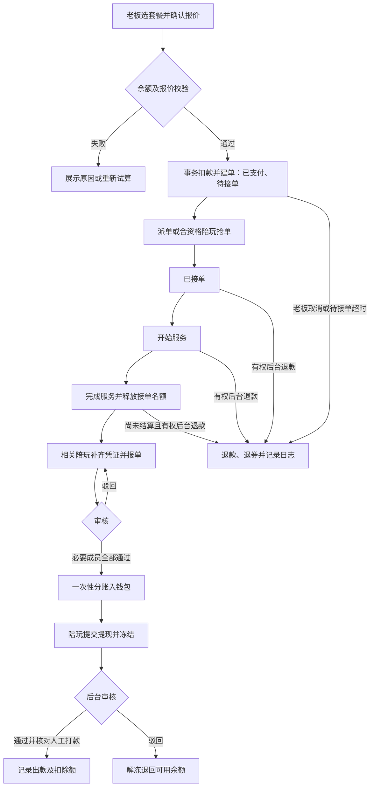

# 兴安电竞三端系统 · 当前产品需求与验收基线

更新：2026-09-23。本文按已确认需求及当前源码整理，承接原有计划、原型和开发工作。用于统一现有功能的业务口径，不代表新增商业规则已获确认，也不代表系统已经上线。

历史 [PRD v1.0](PRD.md) 保留作变更追溯。当前功能与规则以本文为入口，部署和验证证据以 [发布与联调说明](RELEASE_READINESS.md) 及各专项记录为准。发生差异时应核对对应源码和需求，不得以历史文档覆盖当前资金规则。

部署条件已补充：腾讯云，主域名 `xaesports.club`，约 1000 名老板、200 名陪玩，高峰约 100 名老板及 50–60 名陪玩在线。具体采购规格、预算、备案和云数据库版本尚未确认；建议与现有编排差距见 [腾讯云部署方案](TENCENT_DEPLOYMENT_PLAN.md)。这些人数是用户目标，不是已有压测成绩。

托管 MySQL 已增加独立部署配置，并在隔离的本地 TLS 数据库完成迁移、连接拒绝及 56 项关键回归；云端实例验收仍待资源准备，见 [托管部署说明](MANAGED_MYSQL_DEPLOYMENT.md)。

报单、充值、查外挂和站内聊天图片已实现权限签发、15 分钟有效期及预览续签；公开媒体入口使用目录白名单，客服实时推送按当前权限过滤，见 [凭证与客服访问专项](PRIVATE_MEDIA_AUDIT_20260923.md)。限时链接可在有效期内被持有人转发，不能等同于防截图或文件防复制。

## 1. 产品边界与交付状态

俱乐部的主流程为：客服人工收款 → 后台凭证充值 → 老板用兴安币下单 → 后台派单或陪玩抢单 → 履约 → 报单审核 → 收益入账 → 提现审核及人工打款。

| 端 | 用户与职责 | 当前实现入口 |
| --- | --- | --- |
| 老板端 | 原生微信小程序，挑选服务与陪玩、下单、订单、评价、钱包记录、运营活动、客服 | `apps/boss-miniapp/native/`，原生 JS / WXML / WXSS |
| 陪玩端 | 响应式 H5，接单、服务、报单、收益、提现、资料、语音、评价回复、通行证 | `apps/provider-miniapp/src/`，Taro / React / TypeScript |
| 管理端 | Web 后台，账号、派单、审核、资金、营销、权限、内容和通知管理 | `apps/admin-web/src/`，Vue / Element Plus |
| 业务服务 | HTTP API、WebSocket、任务、持久化和外部消息集成 | `services/backend/`，Django / DRF / Channels / Celery，MySQL / Redis |

老板端旧 `src/` 下的 Taro 页面属于历史兼容实现，不是原生小程序验收入口。原生小程序当前注册 40 个路由，其中 24 个业务页面、16 个兼容跳转路由；具体清单见 [原生老板端产品说明](BOSS_NATIVE_PRODUCT.md)。

当前已具备主链路和多轮本地测试证据；提现账户按用户确认的“微信、支付宝、银行卡各保存一个”实现绑定、修改、解绑与申请快照隔离。WSL 完整容器部署和微信开发者工具真实 OpenID 登录绑定已验证，详情见 [本地部署验收](LOCAL_DEPLOYMENT_VALIDATION.md)。手机号授权、真机、外部消息和正式服务器仍待验收。参考小程序“小樱电竞”尚未取得可检查的实际页面，不能声称已完成对标拆解或逐页还原。

## 2. 三端功能与交互要求

### 2.1 老板端

- 全端沿用用户选择的柔和社交风格：浅色底、莓粉强调色、系统字体，统一按钮、表单、间距和状态。具体布局与预览边界见 [设计规范](BOSS_NATIVE_DESIGN.md)。
- 首页、陪玩、服务、消息、我的构成主导航。固定操作栏须给内容和安全区留空间；不以占位加载文案充当真实内容。
- 服务按同一玩法聚合展示，套餐档位在服务详情内部切换。切换只更新选中项和有关报价信息，保留当前页面；过期请求不得覆盖最新选择。
- 服务分类为“体验单、常规单、陪玩单、趣味单”，计数采用“项目数量”，默认按价格排序。游戏、玩法、套餐、平台、难度与履约要求由后台目录提供。
- 挑选陪玩支持项目/服务资格、关键词、参考时价区间及排序、有语音筛选。**价格口径使用后台陪玩档案时价，必须标明仅为参考时价；实际下单按服务套餐报价。** 未配置时价与明确配置为零需区分；未配置者不进入价格区间结果，价格排序放末尾。陪玩列表的默认排序与服务目录的默认价格排序分别处理。
- 下单使用服务端试算，展示数量、套餐、折扣、实付和余额。余额不足引导联系已配置客服；无自助充值和微信支付入口。
- 用户可查看自己的订单、支付/退款状态、履约信息和评价；客服入口携带业务编号及订单上下文。钱包和消息支持历史记录加载。
- 对加载、无数据、失败重试、登录失效分别呈现明确状态；账号切换清理个人数据，迟到请求不能写入新账号页面。

### 2.2 陪玩端

- 公共单池按资格、档期、接单容量及通行证可见延迟过滤。支持抢单、接收指派、拒单回池、开始和完成服务。
- 报单关联实际订单与本人份额，上传入队截图、结单截图及至少一张战绩截图；驳回后允许补充重提。
- 钱包展示可用/冻结金额、收益与资金流水；奖励扣罚和礼物明细使用全量汇总与分页。礼物区分预计分成、实际到账、待结算及待核对，不能把未入账金额计为已到账收益。
- 提现按服务端试算提交，申请后由后台审核及人工打款。微信、支付宝、银行卡各保存一个收款账户；申请时选用已绑定账户，服务端核对归属和版本并保存独立收款快照。
- 管理个人资料、接单项目、档期和语音条；语音支持上传、试听与移除。本人不可修改后台受控的认证、等级等字段。
- 支持回复本人收到的评价；错误可重试，不能回复其他陪玩的评价。
- 通行证按后台当前规则购买及续费，展示有效期、价格、可见延迟和购买记录。它影响公共单池可见时间，不承诺抢单成功。

### 2.3 管理端

| 功能域 | 运营能力与结果 |
| --- | --- |
| 账号与权限 | 老板资料/类型，陪玩开户/认证/等级/接单资格，封禁及解封，后台员工和角色权限 |
| 项目与定价 | 游戏、玩法、服务套餐、价格档位、履约要求、上下架、活动与抽成配置 |
| 订单履约 | 代建订单、派单、双陪、转单、异常处理、退款、超时、群派单记录 |
| 报单审核 | 查验三类凭证、驳回补充、必要成员全部通过后统一结算 |
| 财务 | 人工充值、收款流水与凭证、余额与冻结、押金、奖罚、提现审核、打款凭证、报表 |
| 运营 | 优惠券、促销、签到/补签/满签奖励、成就、公告、消息、内容及客服名片 |
| 商业化 | 通行证日价、公共池延迟及购买记录；扣款和平台收入对应 |

菜单及其操作路径见 [后台功能核对](ADMIN_FUNCTION_AUDIT.md) 和 [业务闭环记录](BUSINESS_CLOSURE.md)。历史记录中的菜单数和测试数带有阶段日期，不应当作最新覆盖率。

## 3. 身份、登录与权限

微信快捷登录先用一次性 `wx.login` code 查询绑定。`checkOnly:true` 未匹配时返回 `requiresBinding`，不自动建立新账号；匹配已绑定老板后返回业务登录态。

未绑定用户可授权微信手机号识别唯一历史老板；再次获取新的登录 code，与手机号授权 code 分别提交。冲突、账号停用、手机号归属不唯一或角色不符时拒绝绑定，不覆盖账号和资产。新用户须明确选择创建账号。已登录未绑定的账号通过绑定接口建立关联。界面读取后端 `isWechatBound`、`isPhoneVerified` 和 `bindingState`，不靠手填手机号推断验证状态。完整协议见 [原生产品说明](BOSS_NATIVE_PRODUCT.md)。

| 身份 | 数据与操作边界 |
| --- | --- |
| 老板 | 本人钱包、订单、游戏资料、消息和优惠券；不直接操作陪玩收益或后台财务 |
| 陪玩 | 本人的资料、已归属订单及报单、收益、提现、评价回复；公共池仅返回可见订单 |
| 后台员工 | 同时满足后台登录资格、功能权限与操作权限；只读权限不能提交对应变更 |
| 平台系统账户 | 收益归集与账务记录，不作为普通用户登录 |

业务身份使用 `ClubAccount`；历史 `CustomUser` 与映射保留兼容。查询优先匹配业务账号，仅在记录尚未关联业务账号时使用旧用户回退，不能假设两套自增 ID 相同。后台操作保留操作人及审计记录。

同一客户端运行实例中，退出或重新登录后，旧请求及凭证刷新结果不得覆盖新会话；网络暂时失败不得等同于凭证失效。原生端已有版本隔离，陪玩与管理端补齐情况、40 项专项及真实 HTTP 验证见 [会话验收](AUTH_SESSION_AUDIT_20260923.md)。

已建立实时连接须在心跳与每次推送前重查账户、后台成员资格和令牌有效期。停用或身份变更后停止推送；单项权限移除只停止对应数据。有效刷新令牌可用于正常到期恢复，后台资格失效则拒绝刷新并走登录失效流程。实现与实测见 [实时权限验收](LIVE_AUTHORIZATION_AUDIT_20260923.md)，此机制不等于全局 JWT 撤销。

## 4. 资金、计价与分账规则

### 4.1 兴安币

**1 元人民币 = 10 兴安币 = 100 内部账务单位；1 兴安币 = 10 内部账务单位。** 后端以整数账务单位保存和计算；展示兴安币时除以 10，人工收款/打款核对人民币时除以 100。不能在页面里把内部单位直接当成兴安币或人民币元。

人工充值记录实收人民币、换算币额、赠币、收款流水号、凭证和实际客服；同一收款流水不得重复充值。订单、通行证、提现和押金使用请求标识及事务控制重复资金写入。网络结果不明不能直接当作“未扣款”；应核对订单/申请和账务结果。

下单、打赏、通行证、押金和提现的成功回执与资金事务一起保存。同编号重试可恢复原结果，不能用同编号改变接口或载荷；旧编号缺少回执时保留待核对状态，不凭金额猜测订单。恢复后另行确认的购买使用新编号。实现与证据见 [资金请求恢复专项](FUND_RECOVERY_AUDIT_20260923.md)。

### 4.2 套餐报价、会员、活动与券

下列金额均为内部账务单位，`//` 为向下取整；百分比 `100` 表示原价：

```text
原价 = 套餐单价 × 购买数量
会员后金额 = 原价 × 老板类型折扣率 // 100
若生效活动配置了折扣率：实付 = 会员后金额 × 活动折扣率 // 100
否则若使用券：实付 = 会员后金额 − min(券面额, 会员后金额)
否则：实付 = 会员后金额
```

券门槛按会员后金额判断；活动折扣与优惠券互斥，客户端不能强制叠加。只配置抽成、未配置折扣率的活动不因此禁止用券。生效活动需处于有效时间、启用并适用该商品，多活动按配置优先级及开始时间选一条。优惠券领取需检查模板启用、有效期、库存及同账号是否已领；使用时检查归属、未使用状态、期限和门槛。当前模板停用阻止新领取，不直接作废已领券。

提交订单重新校验服务器报价；与用户确认的 `expected_amount` 不一致时返回价格变化，不扣款。订单保存成交金额、折扣、套餐与玩法快照，后续修改目录不能改写历史成交事实。相关实现：`orders/pricing.py`、`orders/serializers.py`、`orders/views.py`。

### 4.3 陪玩、平台与邀请人分账

百分比抽成的优先级为：活动配置 → 有效陪玩等级 → 商品配置 → 全局配置；取一个来源，不相加。下单时未指定陪玩，不能用未知陪玩等级报价，使用当时可解析的店铺规则；具体成员以已保存的分账快照结算。

```text
百分比平台抽取额 = 结算基数 × 抽成率 // 100
固定平台抽取额 = min(配置的非负固定金额, 结算基数)
陪玩收入 = 结算基数 − 平台抽取额
邀请人佣金 = 平台抽取额 × 邀请比例 // 100
俱乐部收入 = 平台抽取额 − 邀请人佣金
```

双陪先分配订单实付基数，再分别计算成员分账；整除余数归较前成员，不能让每人各按完整订单实付领取一次收益。转单保留已赚取的正数份额，已退出且无份额者不再参与必要报单与结算。所有收款方分账总和必须等于订单实付。

已确认示例：实付 80 元，即 800 兴安币，在 20% 抽成且无邀请人分成时，陪玩得 640 兴安币、俱乐部得 160 兴安币。配置缺失时的当前代码回退抽成是 20%；这是现状记录，不据此新增或重置运营配置。

### 4.4 通行证

每次购买 1 天；同档有效通行证从原到期时间顺延，已过期则从当前时间起算。有效期内不允许直接购买另一档。购买前展示当前日价；价格变化拒绝旧价请求。余额扣款、购买记录、有效期和平台 `PASS_INCOME` 在同一事务提交。

| 档位 | 未配置时的当前回退日价（兴安币） | 公共单池可见延迟 |
| --- | ---: | ---: |
| BLACK | 500 | 0 秒 |
| GOLD | 300 | 30 秒 |
| SILVER | 100 | 60 秒 |
| BRONZE | 20 | 120 秒 |
| 无有效通行证 | — | 300 秒 |

以上为 `wallet/models.py` 的现有回退值；实际规则读后台配置，保存时校验档位完整、价格及延迟顺序。延迟结束后仍需通过认证、押金、档期、封禁和容量等资格校验。

### 4.5 提现

申请金额为正整数量纲的账务单位，需满足后台最低额与可用余额。当前缺省最低额为 10000 内部单位，即 1000 兴安币/100 元，实际值以后台配置为准。

```text
扣除额 = 四舍五入到整数账务单位(申请金额 × 配置税率 / 100)
实际打款额 = 申请金额 − 扣除额
人民币打款金额 = 实际打款额 / 100
```

试算与申请需一致；提交事务中重新检查当前税率及金额，变化时要求重新试算，不能按旧报价冻结。申请一次性减少可用余额并增加冻结额；审核通过核对打款金额、时间与凭证，记录出款和扣除额；驳回退回可用余额。重复审核不得重复出款或解冻。

用户已确认：**微信、支付宝、银行卡各保存一个收款账户**。陪玩在钱包“管理账户”中绑定、修改或解绑，零余额也可管理；列表显示掩码，编辑和提交提现时展示完整资料供本人核对。仅本人可访问和修改，数据库约束同账号同方式只有一条。

编辑和解绑携带账户 ID 与版本，过期页面不得覆盖新资料；删除后重新绑定也不能被旧页面覆盖。提现携带绑定 ID 与版本，服务端在冻结前锁定本人的账户并核验版本，失效则要求重新核对，不冻结、不占用请求编号。收款方式、账号、姓名及金额复制到申请中成为独立历史快照，后续修改或解绑不能改写已有申请。已成功请求的回执仍可在绑定变化后恢复。接口、迁移与验证见 [提现账户专项](WITHDRAWAL_ACCOUNTS_AUDIT_20260923.md)。

## 5. 订单、结算与异常流程

订单状态、支付状态和结算时间分别存储。新服务订单使用 `REPORT_APPROVAL`；历史 `COMPLETION` 订单保留旧结算模式，不能无条件按新规则重复结算。



| 阶段 | 允许的操作与约束 |
| --- | --- |
| 待接单 `PENDING` | 未指派公共订单可抢单；管理员派单也必须校验资格和容量；老板仅能取消自己的待接单订单 |
| 已接单 `GRABBED` | 开始服务；按业务校验拒单回池或后台处理；离开公共池时清除旧超时点 |
| 服务中 `IN_SERVICE` | 完成履约；转单保存成员份额；有权后台可在未结算范围处理退款 |
| 已完成 `COMPLETED` | 新订单等待必要成员报单通过，完成履约不等于收入已入账；已结算订单不可直接全额退款或重新流转 |
| 已取消 `CANCELLED` | 不再履约或结算；只有原先已支付金额能退回钱包，未支付单不产生退款资金 |

必要报单成员包括仍参与服务的成员，以及已退出但保留正数结算份额的成员。审核顺序先锁订单再锁报单，重复审核或审核与退款同时发生时只能提交一致结果。原生老板端、陪玩端和后台同步展示最终状态；实时通知失败不撤销已成功的资金事务。

当前待接单超时为 30 分钟；延迟任务及兜底扫描在订单锁内重新确认状态和期限，不能取消已被接走或期限已改变的订单。退款只退实付，关联已用券恢复为未使用并解除订单关联；券再次使用仍须通过当时的归属、状态、有效期和门槛检查，不延长原有效期。

更完整的双陪、转单、并发和退款验收见 [订单流程专项](ORDER_FLOW_AUDIT_20260922.md)。

## 6. 核心数据关系

| 数据 | 用途与关系 |
| --- | --- |
| `ClubAccount` / `LegacyAccountMap` / `CustomUser` | 业务账号、历史用户映射与兼容；防止同数值 ID 被误认作同一账号 |
| `EscortProfile` / `EscortSchedule` / `EscortLevel` | 陪玩资料、语音、参考时价、认证/押金/通行证状态、接单档期和等级 |
| `GameCategory` / `ServiceCategory` / `Gameplay` / `ServiceItem` | 游戏、服务分类、玩法与可购买套餐；价格和履约规则来源 |
| `Order` / `OrderProvider` | 订单成交和玩法快照；单陪/双陪/转单的成员基数、抽成、收入、退出及结算时间 |
| `OrderStatusLog` / `ProviderDispatchLock` | 流转审计及跨订单接单容量互斥 |
| `Wallet` / `Transaction` / `IdempotencyKey` | 可用/冻结资金、带前后余额的流水、资金写入防重、接口/载荷指纹和成功回执 |
| `RechargeRecord` / `WithdrawRequest` / `DisposeRecord` | 人工充值及凭证、提现收款快照与审核、奖励扣罚 |
| `WithdrawalAccount` | 陪玩本人按微信/支付宝/银行卡分别保存的账户及版本；与申请收款快照独立 |
| `ProviderReport` / `ProviderReportImage` | 与订单和陪玩关联的报单、三类凭证及审核结果 |
| `ProviderPassPurchase` / `SystemConfig` | 通行证采购快照与运营规则 |
| `Coupon` / `UserCoupon` / `Promotion` | 券模板及领取/使用归属、生效促销 |
| `Evaluation` / `CustomerGameProfile` | 订单评价与回复、老板常用游戏信息 |
| `KookDispatchRecord` / `WecomDispatchRecord` | 订单每轮渠道发送、失败及未知结果追踪 |
| `AdminRole` / `AdminMembership` / `AdminAuditLog` / `AccountBan` | 后台权限、操作审计、账号限制 |

具体字段以模型与迁移为准；历史 ER 图保留追溯用途，不视为当前迁移清单。`WithdrawalAccount` 管理后续申请可选择的资料，`WithdrawRequest` 保留每笔申请提交时的事实，二者不能混用。

## 7. 外部集成与配置边界

| 集成 | 当前行为 | 配置入口 |
| --- | --- | --- |
| 微信登录/绑定 | 真实微信接口换取身份，业务 JWT 登录；开发 Mock 不能用于正式发布 | 服务端 AppID / AppSecret，原生环境配置与小程序合法域名 |
| KOOK 自动派单 | 向指定频道发送符合条件的待接单卡片；陪玩回 H5 抢单 | 服务端 Bot Token、频道 ID、启用与发送范围开关，机器人频道权限 |
| 企微群派单 | 群机器人发送派单文案，保存独立渠道记录 | 服务端完整群 Webhook、启用和发送范围开关 |
| 企业微信客服 | 小程序打开官方客服会话，由企微原生工作台接待 | 后台客服名片的 `wecom_corp_id`、`wecom_service_url`，平台坐席及小程序关联 |

自动群发仅覆盖已支付、有效期内、未指定陪玩的单陪待接单及符合条件的拒单回池订单；双陪、已指派和礼物订单不进入该广播范围。对外卡片展示冻结的陪玩实得和必要履约信息。同订单同轮次按渠道去重；明确失败可重试，结果未知先核查频道。

KOOK 内按钮抢单/指令与身份绑定、XA 后台直接收发企微客服消息、KOOK 全勤身份组自动授予均未实现，不能通过填写现有密钥自动获得这些能力。当前原生客服入口不要求 XA 保存客服回调 Token 或 EncodingAESKey。完整配置项、官方来源及区分见 [集成凭证清单](INTEGRATION_CREDENTIALS.md)。

## 8. 需求与验证证据矩阵

“已有实现/本地验证”表示源码和指定环境的证据，不等于真实平台已验收。本表不把不同阶段的测试数相加为覆盖率。

| 原始需求 | 当前状态 | 可核对的证据或剩余工作 |
| --- | --- | --- |
| 原生老板端及全端柔和风格 | 已有实现/本地预览、官方编译 | [原生产品](BOSS_NATIVE_PRODUCT.md)、[设计规范](BOSS_NATIVE_DESIGN.md)；仍需真机布局、键盘、安全区和授权验证 |
| 参考“小樱电竞”拆解 | 未完成实物对标 | 尚无实际参考页面证据，现有预览不能代替 |
| 后台时价筛选、资料和语音联动 | 已有实现/本地验证 | [资料与语音专项](PROVIDER_PROFILE_AUDIT_20260923.md)；实际支付仍按套餐 |
| 下单、派单、抢单、履约、报单和结算 | 已有实现/本地 HTTP 与数据库验证 | [订单流程专项](ORDER_FLOW_AUDIT_20260922.md)，含独立 MySQL 连接并发 |
| 人工充值、无自助充值/微信支付 | 已有实现/本地验证 | [业务闭环](BUSINESS_CLOSURE.md)、[发布口径](RELEASE_READINESS.md) |
| 微信快捷登录与账号绑定 | 开发者工具真实微信 OpenID 登录/绑定通过 | [本地部署验收](LOCAL_DEPLOYMENT_VALIDATION.md)；真实手机号授权、历史手机号账号合并和真机仍待验收 |
| 提现试算、申请和审核 | 已有实现/本地验证 | [提现与评价专项](WALLET_REVIEW_AUDIT_20260923.md) |
| 保存/绑定提现账户 | 已有实现/本地验证 | [提现账户专项](WITHDRAWAL_ACCOUNTS_AUDIT_20260923.md)；每种方式一个，包含权限、并发、旧版本拒绝与历史快照隔离 |
| 收益、礼物、奖罚与历史明细 | 已有实现/本地验证 | [收益记录专项](BENEFIT_RECORDS_AUDIT_20260923.md)，含分页与实际到账汇总 |
| 评价回复 | 已有实现/本地验证 | [提现与评价专项](WALLET_REVIEW_AUDIT_20260923.md)，含角色与归属检查 |
| 通行证价格、优先级和采购闭环 | 已有实现/本地验证 | [业务闭环](BUSINESS_CLOSURE.md)、本文件 §4.4 |
| 管理端运营/财务/营销/RBAC | 已有实现/分阶段本地验证 | [菜单核对](ADMIN_FUNCTION_AUDIT.md)、[业务闭环](BUSINESS_CLOSURE.md)；正式角色授权仍需按实际员工配置 |
| KOOK、企微群、原生客服 | 已有实现，外部接口模拟验证 | [集成清单](INTEGRATION_CREDENTIALS.md)；真实机器人、频道与坐席未联调 |
| 生产构建和部署链路 | WSL 完整 Docker 部署、本机 160 人短时协议负载及 60 人同单争抢通过，未公网发布 | [本地部署验收](LOCAL_DEPLOYMENT_VALIDATION.md)；公网 TLS、小程序上传/审核、云端持续负载与容量余量未完成 |

最新 [WSL 部署验收](LOCAL_DEPLOYMENT_VALIDATION.md)：修复提现并发死锁、推送刷新堆积和列表重复查询，追加托管库配置、凭证访问及实时权限回归后，全量 MySQL **1003 项中 991 通过、12 项按环境跳过，无失败**；真实网关业务闭环、开发者工具 OpenID 登录绑定通过。[提现账户专项](WITHDRAWAL_ACCOUNTS_AUDIT_20260923.md) 记录确定性交错测试，[本地容量验证](LOCAL_CAPACITY_VALIDATION.md) 记录性能问题与修复，最新权限策略下 160 人复验为 2,936 请求零错误、p95 730 ms，仍需云端持续负载及延迟目标验收。此前 SQLite 完整回归、客户端 44 项、收益与看板 MySQL 专项 25 项、发布配置与原生自动检查 35 项、模拟 Docker 部署脚本检查 5 项均保留各自阶段证据。官方编译覆盖 41 个 WXML、42 个 WXSS。不同阶段数字不叠加为覆盖率，亦不代表生产验收。

## 9. 剩余交付条件

1. 在能够访问参考小程序时补做交互与页面结构拆解，记录与当前原生版的差异及采纳范围。
2. 配置真实小程序、生产域名和第三方渠道，完成微信真机登录/绑定、语音/上传、服务选择、充值联系入口及完整订单资金链路联调。
3. 在目标服务器执行实际发布与数据库预检，包含 `wallet.0027_saved_withdrawal_accounts` 迁移，验证 TLS、静态和媒体文件、Worker/Beat、实时通知及外部消息；记录人工充值和提现测试对应的凭证与流水。
4. 按实际运营人员配置权限，核对初始化目录、价格和营销规则，再形成上线验收记录。当前状态不满足“整体交付完成”。
