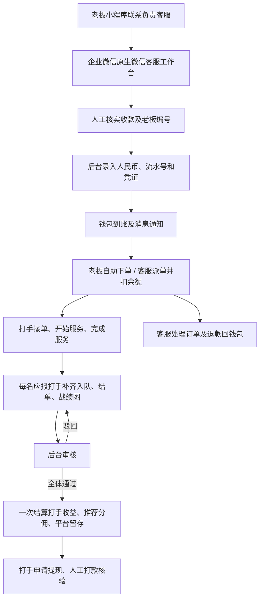

# XA 发布与联调说明

2026-09-28 公网部署增量：腾讯云 `43.167.213.74` 的三端配套和 HTTPS 已部署，云端 1,069 项回归零失败，微信开发版本 `2026.9.28` 上传成功，用户确认手机预览和手机号授权正常。最新入口、数据迁移、每日备份和仍待正式提审的事项见 [腾讯云实际部署验收](TENCENT_DEPLOYMENT_20260928.md)。下文 2026-09-23 内容保留为历史阶段记录。

更新：2026-09-23。本文件记录当前源码、验收证据和上线条件；历史产品文档存在时间差，以这里的发布口径为准。

当前需求、资金公式、数据关系和逐项交付状态见 [当前 PRD](PRD_CURRENT.md)。提现账户已按确认规则实现微信、支付宝、银行卡各保存一个，支持修改、解绑及申请快照隔离；真实参考小程序拆解、微信真机和外部平台联调仍未完成，不能将本地测试通过等同于全部需求交付。

用户已选腾讯云与 `xaesports.club`，目标高峰约 160 人在线。推荐资源、域名规划、备份和待适配项见 [腾讯云部署方案](TENCENT_DEPLOYMENT_PLAN.md)。下文 remote + release 命令部署内置 MySQL；托管数据库已新增独立编排，配置与切换步骤见 [托管部署说明](MANAGED_MYSQL_DEPLOYMENT.md)。

业务图片已按归属及后台权限签发限时地址，三个媒体入口阻止旧凭证直链，预览自动续签、客服推送权限与访问日志脱敏均已验证，见 [凭证与客服访问专项](PRIVATE_MEDIA_AUDIT_20260923.md)。前后端与 Caddy 规则须同步部署，当前实现基于本地媒体卷，尚未接入私有 COS。

2026-09-23 最新验收：[WSL 完整容器部署](LOCAL_DEPLOYMENT_VALIDATION.md) 已运行 MySQL、Redis、Daphne、Celery、网关与两端 H5，开发者工具真实 OpenID 登录及绑定通过。全量 MySQL 回归发现并修复提现资料变更与申请之间的死锁；后续容量测试继续修复推送刷新堆积和列表重复查询。追加托管库配置、凭证访问及实时权限回归后，当前 **1003 项中 991 通过、12 项按环境跳过，无失败**；真实网关业务闭环复验通过。最新权限策略下的 160 人短时复验为 2,936 请求零错误、p95 730 ms，详见 [本地容量验证](LOCAL_CAPACITY_VALIDATION.md)；云端持续负载及读取延迟目标尚未验收。手机号授权、微信真机、公网环境与外部消息仍待验收。

数据迁移仍须包含 [资金请求恢复专项](FUND_RECOVERY_AUDIT_20260923.md) 的 `wallet.0026_idempotency_receipt` 和 [提现账户专项](WITHDRAWAL_ACCOUNTS_AUDIT_20260923.md) 的 `wallet.0027_saved_withdrawal_accounts`。此前完整 SQLite 回归 946 项、MySQL 专项 21 项、客户端 44 项以及 H5 检查与官方编译均为各自阶段证据；下文保留其记录，不叠加为最新覆盖率。

三端实时连接已补齐心跳超时、旧连接隔离与恢复刷新，最新 49 项客户端回归和实际双 Web 停机恢复通过，见 [恢复专项](REALTIME_RECOVERY_AUDIT_20260923.md)。用户确认 KOOK 和微信客服尚未开通；开通、配置位置及真实验收顺序见 [开通指引](KOOK_WECOM_SETUP.md)。

后续 [会话隔离专项](AUTH_SESSION_AUDIT_20260923.md) 修复两端退出后迟到刷新、账号切换后的旧响应和网络故障误退出。新增 40 项检查，客户端组合回归 **89 项通过**，实际网关认证链路通过，H5 镜像已更新；该结果不替代跨标签页统一退出或真机验收。

[实时权限专项](LIVE_AUTHORIZATION_AUDIT_20260923.md) 补齐旧连接在心跳和推送前重查封禁、后台成员资格及令牌有效期；实际封禁、成员停用和令牌到期后的恢复通过。后端镜像已更新，新增 12 项检查，相关客户端 55 项通过；本次不涉及全局 JWT 撤销。

## 1. 当前结论

已补齐并测试“客服收款 → 后台充值 → 老板余额下单/客服派单 → 打手履约 → 报单审核 → 钱包结算”的主链路。老板微信小程序、打手 H5、运营后台均能构建。当前产物是本地验收构建，尚未注入真实生产域名、部署公网服务、完成微信真机及企业微信账号联调，因此不能据此宣称已经正式发布。

一期明确不接微信支付商户下单、支付回调或自动退款 API。客服在企业微信原生微信客服工作台接待，核实实际收款后到 XA 后台入账。打手端沿用仓库既定的 H5 交付形态；目录名 `provider-miniapp` 为历史命名。

## 2. 系统结构

| 单元 | 技术与职责 | 正式产物 |
| --- | --- | --- |
| 老板端 | 微信原生 JS/WXML/WXSS，微信登录、选服务、余额下单、查单、联系企业微信客服 | `apps/boss-miniapp/native`，微信开发者工具导入 `apps/boss-miniapp`；Taro/H5 代码保留兼容 |
| 打手端 | Taro 4 / React，账号登录、接单履约、凭证报单、提现 | `apps/provider-miniapp/dist-h5`，HTTPS 网站 |
| 管理端 | Vue 3 / Element Plus，派单、充值、审核、退款、账号与权限、客服名片 | `apps/admin-web/dist`，HTTPS 网站 |
| 后端 | Django 6 / DRF / Channels / Celery，统一账户、订单、账务、权限与消息 | Daphne + MySQL + Redis + Worker + Beat |
| 共享包 | `packages/money` 负责金额边界换算，`packages/design-system` 提供主题与样式 | 跟随各端构建 |

业务身份使用 `ClubAccount` JWT；旧用户表与新账户映射仍保留。新增主流程测试使用真实业务 token，并关闭旧 `force_authenticate` 兼容分支，避免只在测试身份下可用。



## 3. 资金与状态约定

### 客服充值

- **1 元人民币 = 10 兴安币 = 100 内部账务单位**；API 和数据库使用整数账务单位。
- 表单录入实收人民币，赠币单独填写；例如实收 100 元、赠送 20 币，到账 1,020 币，内部值为 10,200。
- `POST /api/admin/wallets/recharge/` 要求充值权限、有效账号、正整数金额、真实图片及核实过的收款流水号。新发布配置强制凭证必填。
- 收款流水全局唯一，兼容查重历史记录；重复点击/网络重试使用 `client_request_id` 防止再次入账。重复请求会返回冲突，操作员应核对账目记录，不应更换流水号重复充值。
- 充值记录、余额、实充/赠币累计、资金流水在同一数据库事务内更新；异常全部回滚。消息在提交后发送。
- 用户自助充值接口仍关闭。后台“调账”是单独的权限，不应代替有收款凭证的充值流程。

### 履约与报单

- 订单状态为 `PENDING → GRABBED → IN_SERVICE → COMPLETED`。`COMPLETED` 表示服务完成，结算是否完成由 `settled_at` 判断。
- 新订单保存 `REPORT_APPROVAL` 结算模式。完成服务后生成各打手的草稿，收益暂不入钱包。
- 每名打手补齐入队、结单、1–9 张战绩图后提交；状态为 `DRAFT → PENDING → APPROVED/REJECTED`。
- 草稿与驳回状态可以更换入队/结单图、删除误传战绩图；待审核与已通过状态不能修改。删除只移除草稿图片引用，原文件按媒体保留策略统一处理。
- 金额、抽成、预期收入读取订单/本人分账快照；打手提交的抽成不能修改既定分账。固定抽成与百分比抽成都保留原快照。
- 单陪一人、双陪两人，以及转单后仍有结算份额的旧打手，全部审核通过后统一结算一次。转出打手释放接单容量，但其应得收益仍等待本单审核。
- 极小金额双陪均分为 0 基数的在岗成员也能提交凭证，避免整单等待无法提交的报单；未关联订单的历史手工报单仍要求正金额。
- 待审核完成单可由客服退款回老板钱包；退款后阻止继续提交/审批入账。已结算订单不走这一退款入口。
- 钱包退款不等于向老板的外部支付账户打款；实际收款渠道的退款由客服另行核实处理。

### 历史兼容

迁移把已有订单保留为 `COMPLETION`（原完成即结算）模式，已完成且已支付订单回填结算时间；新订单使用审核后结算。历史订单补审凭证不会重复发钱。既有未关联订单的报单保留审核兼容，新的打手页面只创建关联订单报单。

审核结算的新订单允许打手转回本单，恢复接单标记、累计既有份额，最终只结算一次。历史完成结算模式下，已经收到本单转单收益的打手不能再次转入同一订单，避免复用已付款的分账行导致重复支付。

## 4. 本次补齐的具体缺口

1. 原打手报单目录只有配置，没有实际页面。现有完整列表、状态、驳回原因、凭证上传/预览/删除、提交及订单入口，并接入桌面和手机导航。
2. 原有完成动作直接打款，与人工审核口径冲突。现已拆分服务完成、凭证审批和最终结算，增加订单级防重标识及迁移兼容。
3. 补齐真实 JWT 下开始服务、完成服务和报单创建的账户关联；单陪、双陪和转单均有覆盖。
4. 充值增加金额边界校验、凭证要求、收款流水唯一键、请求防重及回滚验证；派单增加请求防重。
5. 客服入口按订单绑定名片或下单选择的名片打开，携带当前老板编号与订单上下文；未配置时展示空状态，移除虚构客服号和随机二维码。
6. 三端统一 WebSocket 根路径 `/ws/orders/`，服务端保留旧 `/api/ws/orders/` 兼容；打手 H5 使用正确的同源协议转换，并验证真实 token 握手、心跳、账号消息推送及匿名拒绝。
7. 修正各前端 Docker 构建缺失的共享金额包，以及打手镜像错误复制微信 `dist` 而非 H5 `dist-h5` 的问题。
8. 增加正式构建配置检查、HTTPS 网关编排和首次运营管理员初始化命令；微信工程开启域名校验与压缩，关闭源码映射上传。
9. 报单页按实际桌面/手机预览修正字号与深色模式按钮；打手“其他拒单原因”改用可输入文本的现有弹窗组件。
10. 修复转回原打手后“已转出”标记残留；补上履约上传的真实图片校验，并正确处理 Django 与 DRF 两种校验异常，损坏图片不会引发服务器错误、推进状态或入账。
11. 真实 MySQL 复现并修复不同订单同时争抢同一打手名额的问题。抢单、老板指定下单、两种客服指派、快捷派单及转单共用独立名额锁；多打手按账号排序获取，容量检查在扣款前完成。
12. MySQL 全量回归发现并修复消息表单把多位编号拆成单个数字的问题；封禁唯一约束改用数据库生成列，兼容 MySQL，阻止重复生效记录。历史重复封禁会让迁移明确停止，需核对审计后处理。
13. 增加只读 `check_mysql_readiness` 命令，检查事务隔离、InnoDB 和命名时区表。正式发布编排在迁移后执行，未通过则不启动业务服务；CI 新增完整 MySQL 迁移和并发测试任务。
14. 打手工作台与接单共用名额统计，排除已转出成员；今日订单按北京时间自然日统计，与收益趋势保持一致。
15. 登录页和登录弹层接入微信 `openPrivacyContract` 隐私保护指引入口，移除纯展示的“已同意”勾选和无法打开的协议文字，未选头像时使用本地图标；不把点击阅读当作授权记录。补齐老板 H5 预览的根主题变量和图标尺寸换算。
16. 增加一键发单预览、复制、KOOK 频道及企业微信群机器人投递。发单文案只包含打手实得，活动按折后成交价重新抽成；同步修正快捷派单报价和打手页面金额。人工与自动投递共用防重记录，超时结果保留待核对状态，避免盲目重发。配置与限制见 [一键发单说明](GROUP_DISPATCH.md)。

## 5. 已执行的验证

2026-09-23 前期增量验收：原生老板端见 `BOSS_NATIVE_PRODUCT.md`；资料、参考时价和语音见 `PROVIDER_PROFILE_AUDIT_20260923.md`；提现试算与评价权限见 `WALLET_REVIEW_AUDIT_20260923.md`；收益明细见 `BENEFIT_RECORDS_AUDIT_20260923.md`。当时 SQLite 完整回归 925 项中 914 项通过、11 项按数据库行锁能力跳过，收益与看板 MySQL 专项 25 项通过。原生与发布配置自动测试 35 项通过，部署脚本的临时 Git 仓库/模拟 Docker 测试 5 项通过，官方编译器检查 41 个 WXML 和 42 个 WXSS 通过。最新完整 MySQL 结果见本文开头及本地部署记录；下表保留前期证据，不代表已完成公网或微信真机验收。

| 验证 | 结果与边界 |
| --- | --- |
| 主链路阶段完整测试 | **MySQL 8.0.46 从空库完整迁移后：754 项全部通过**；SQLite：748 项通过、6 项真实行锁并发测试按数据库能力跳过 |
| 一键发单增量回归 | SQLite 全量回归：773 项中 767 项通过、6 项行锁并发跳过；其后新增的发单并发用例在 MySQL 验证。MySQL 从空库执行含 `0030` 的完整迁移后，发单、计价及并发专项 **59 项全部通过**；SQLite 真实迁移后发单及发布流程 **40 项通过** |
| 完整迁移链后关键验收 | SQLite 从空库执行迁移后 **49 项通过**，包括客服接口、发布流程、WebSocket、管理员初始化和封禁约束 |
| MySQL 从空库迁移 | 完整迁移后 **55 项通过**，包含上述关键验收和 6 个独立连接并发场景 |
| 派单并发 | MySQL 两个独立连接同时争最后一个名额，**6 个场景通过**；指定下单/快捷派单失败时余额不变 |
| 数据库发布预检 | `check_mysql_readiness` 在隔离 MySQL 上通过；READ COMMITTED、InnoDB、UTC/Asia/Shanghai 转换符合预期 |
| 模型/迁移一致性 | `makemigrations --check --dry-run` 通过 |
| 三端 TypeScript | 老板与打手 `tsc --noEmit`、后台 `vue-tsc --noEmit` 通过；第三方声明文件使用 `skipLibCheck` |
| 样式与金额契约 | `style:check` 通过 |
| 构建 | 老板微信、打手 H5、运营后台均通过；H5/后台仍有既有包体大小警告 |
| 本地浏览器 | 隔离数据库与测试账号登录，核对报单列表、驳回状态、充值输入与到账预览；老板登录页另经 390px 预览检查，隐私入口在 H5 正确提示需在微信中查看；不使用生产数据 |
| 发单界面与构建 | 活动价 80 元、20% 抽成的订单预览显示打手实得 64 元；缺少渠道配置时允许复制、禁用群发送。复制按钮显示成功提示，自动化虚拟剪贴板未能验证实际粘贴。后台与打手 TypeScript 检查及构建通过 |
| 发布配置防呆 | 缺少真实 API 域名和匹配 AppID 时正确拒绝发布构建 |
| 尚未验证 | 生产规模压力测试、公网 TLS、小程序上传/审核/真机、真实手机号授权、正式企业微信账号接待、真实 KOOK / 企微群消息投递；WSL 完整 Docker 和开发者工具真实 OpenID 登录绑定已通过，见 [本地部署验收](LOCAL_DEPLOYMENT_VALIDATION.md) |

新增业务测试包括完整充值至结算流程、重放防重、流水异常回滚、损坏/缺失凭证、跨账号读取/删除、驳回重提、双陪全员通过、往返转单份额与历史付款保护、退款后拒绝入账。测试文件：`services/backend/orders/tests/test_release_flow.py`。

MySQL 验收使用仓库内隔离实例、独立测试账号和测试库，不接触生产数据。`config.mysql_test_settings` 只允许 `xa_test_` 前缀库名，并在 `test_xa_test_*` 数据库运行真实迁移和事务测试。并发用例位于 `orders/tests/test_dispatch_concurrency.py`；全量回归也修正了旧测试依赖两套自增 ID 恰好相同的夹具问题。上述结果是功能并发验收，不代表生产吞吐量测试已完成。

可复现检查（Python 3.12+、Node 22+、pnpm 9.0.0）：

```sh
pnpm install --frozen-lockfile
pnpm run typecheck
pnpm run style:check
pnpm run build:all
cd services/backend
python manage.py test --settings=config.test_settings --noinput
python manage.py test support orders.tests.test_release_flow orders.tests.test_release_websocket console.test_bootstrap console.tests_ban --settings=config.migration_test_settings --noinput
python manage.py makemigrations --check --dry-run --settings=config.migration_test_settings
```

MySQL 验收环境配置 `XA_TEST_MYSQL_HOST`（默认 127.0.0.1）、`XA_TEST_MYSQL_PORT`（13306）、`XA_TEST_MYSQL_USER`、`XA_TEST_MYSQL_PASSWORD`；账号须对专用基础库和对应 `test_` 库有建库及迁移权限。确认目标为隔离库后执行：

```sh
python manage.py check_mysql_readiness --settings=config.mysql_test_settings
python manage.py test --settings=config.mysql_test_settings --noinput
```

## 6. 正式部署步骤

### 准备正式配置

复制 `deploy/release.env.example` 为仓库根目录 `.env.release`，填入实际值：

- `XA_API_DOMAIN`、`XA_ADMIN_DOMAIN`、`XA_PROVIDER_DOMAIN`：三个 HTTPS 域名，DNS 指向部署服务器；模板的 example.com 不能用于发布。
- `DJANGO_ALLOWED_HOSTS`：与这三个域名一致。为基础编排的必填插值保留该项。
- `DJANGO_SECRET_KEY`、`MYSQL_ROOT_PASSWORD`、`MYSQL_PASSWORD`：独立强密钥；`MYSQL_USER` 使用非 root 专用用户。
- `WECHAT_APPID`、`WECHAT_SECRET`：老板小程序正式凭证；AppID 必须与 `apps/boss-miniapp/project.config.json` 一致。
- 原生老板端：在 `apps/boss-miniapp/native/config.js` 分别填写 `trial.apiBase` / `release.apiBase`，形如 `https://实际API域名/api`。需要独立 WebSocket 域名时填写对应 `socketBase=wss://实际域名`，不带业务路径；留空时由 API 地址推导。媒体根地址同样由 API 地址推导，后端也可返回完整媒体 URL。
- 陪玩 H5：`TARO_APP_API=/api` 使用发布编排的 HTTPS 同源反代，WebSocket 根据当前站点推导；单独托管静态产物时可填写完整 HTTPS API 地址。`TARO_APP_WS` / `TARO_APP_MEDIA` 只属于保留的旧老板 Taro/H5 配置，不控制原生端或陪玩 WebSocket。

AppSecret、数据库和服务器口令只放部署环境，不写入源码或前端变量。前端构建脚本不会自动读取 `.env.release`，须把公开的 `TARO_APP_API` 与 `WECHAT_APPID` 导入运行构建命令的终端/CI 环境。原生 `native/config.js` 独立配置，不会因设置 `TARO_APP_*` 自动变更。

### 启动服务

部署编排采用基础 `docker-compose.remote.yml` 加 `docker-compose.release.yml`。发布覆盖层固定关闭 Mock 登录、打开充值和订单凭证检查，使用非 root 数据库账号，配置媒体 HTTPS 根地址和跨域白名单。

```sh
docker compose --env-file .env.release -f docker-compose.remote.yml -f docker-compose.release.yml config --quiet
docker compose --env-file .env.release -f docker-compose.remote.yml -f docker-compose.release.yml up -d --build
docker compose --env-file .env.release -f docker-compose.remote.yml -f docker-compose.release.yml ps
docker compose --env-file .env.release -f docker-compose.remote.yml -f docker-compose.release.yml exec web python manage.py check
docker compose --env-file .env.release -f docker-compose.remote.yml -f docker-compose.release.yml exec web python manage.py check_mysql_readiness
docker compose --env-file .env.release -f docker-compose.remote.yml -f docker-compose.release.yml exec web python manage.py bootstrap_console --username your_admin_name
```

最后一步交互输入管理员密码，不回显；拒绝覆盖现有账号。该命令创建可登录运营后台的业务管理员及完整权限映射，不依赖演示账号。

Caddy 监听 80/443 并申请 TLS，通过动态 DNS 解析两个 Web 实例并轮询转发 API 与 WebSocket；静态前端转发到各 Nginx 镜像，媒体与后台静态文件从持久卷提供。release 编排中 Web 不绑定宿主端口，两个前端调试端口仅绑定服务器环回地址，数据库和 Redis 不对公网暴露；Beat 只有一个。两个 Web 共享同一主机，不构成跨主机高可用。需使用支持 `!reset` 的现代 Docker Compose；本机 5.5.1 已解析验证。

首次 MySQL 卷初始化时会创建专用用户。已有数据库升级前先备份数据库和媒体卷，并核对旧数据；已有卷不会因新增环境变量自动创建 MySQL 用户，需要运维显式创建并授权该用户，切勿为此删除数据库卷。本机 WSL 已安装 Docker，并使用隔离的 local-validation 编排完成实跑；以上生产 HTTPS 命令仍须在实际部署主机验收。

自动 SSH 部署要求服务器 `/opt/xa/.env.release`，调用 `deploy/deploy-release.sh`。默认使用 release 叠加编排；GitHub 仓库 Variable `XA_DATABASE_MODE=managed` 时使用独立托管编排，其他未知模式直接拒绝，不会回退 `.env.remote`。代码和镜像绑定同一个完整提交 SHA，标签版本也按提交检出。存在服务器源码改动、配置缺失或镜像拉取失败时停止；不强制重置工作区、不改写环境文件、不清理全机镜像。服务器需 Bash、Git 及支持 `--wait` 的 Docker Compose v2，启动后执行 Django 与 MySQL 预检。多个发布任务按部署队列串行执行。

数据库必须安装命名时区数据，否则 MySQL 的日期转换可能使日统计为空。Linux 按系统 zoneinfo 使用 `mysql_tzinfo_to_sql`，Windows 使用官方时区 SQL 包；导入后按官方步骤重启并重跑预检。参考 [MySQL 时区数据说明](https://dev.mysql.com/downloads/timezones.html)。本地 Windows 隔离验收导入了已安装 IANA tzdata 2026.3 中的 UTC/Asia/Shanghai 数据。

### 初始化运营内容

使用新建管理员登录后台，配置服务类别/商品、打手账号与等级、接单条件、佣金、负责客服名片、必要的首页内容及提现规则。给日常客服分配独立角色；充值、调账、报单审批和提现打款分别按职责授权。

### 微信小程序构建与上传

先核对 `project.config.json` 指向 `native/`，并开启开发者工具“校验合法域名”。存在 `project.private.config.json` 时，以它覆盖后的 `setting.urlCheck` 为准；当前工作区为本地 HTTP 联调保留的关闭设置不能用于发布验收。

在已加载真实构建环境的终端执行（需安装官方开发者工具；非默认路径通过 `WECHAT_COMPILER_DIR` 指定包含 `wcc` 和 `wcsc` 的目录）：

```sh
# 体验版地址检查和官方模板编译
node scripts/check-release-config.mjs --target=trial
node scripts/check-native.mjs --require-compiler

# 正式版配置检查、原生官方编译、类型检查及两端 Web 构建
pnpm run build:release
```

微信开发者工具导入 `apps/boss-miniapp`，直接读取 `native/app.json` 及原生页面，不读取历史 Taro `dist/`。正式命令缺配置或缺官方编译器时失败；普通 `boss:build` 在编译器不可用时只做结构检查。配置 request、uploadFile、downloadFile 和 socket 合法域名，核对生产 API、媒体域名与 WSS 根地址。根据实际使用的微信能力完成平台要求的类目、隐私声明和权限配置，然后真机体验、上传审核并发布。以上本地命令均不执行上传或发布。

登录页的隐私入口打开微信平台为当前小程序配置的真实《隐私保护指引》，必须在小程序管理后台按实际采集项维护；入口点击、手机号授权、头像选择及拒绝授权后的行为均需使用正式 AppID 真机验证。本地 H5 提示和构建成功不能证明微信平台授权已通过。

本地成功构建不代表已通过微信平台审核，也不代表正式 AppID/域名已经联调成功。

## 7. 企业微信客服接入

本次对接边界为**小程序打开原生微信客服会话，坐席在企业微信工作台接待**；XA 负责业务身份、订单与人工记账。仓库已有站内聊天功能不等同于企微会话同步。

1. 在企业微信中开通实际微信客服账号，配置接待人员及接待规则，取得企业 ID 和官方生成的微信客服链接（`https://work.weixin.qq.com/kfid/...`）。
2. 在 XA 管理后台“运营管理 → 客服名片”填写 `wecom_corp_id`、`wecom_service_url`，上传真实客服二维码/备用联系方式并启用。需要每名客服独立入口时分别建名片。
3. 在微信/企业微信管理界面完成该小程序与客服入口所需的关联配置。原生老板端通过 `wx.openCustomerServiceChat` 调起会话。
4. 老板在订单页联系该订单绑定的客服；从下单页充值使用所选客服。客服名片页可复制老板编号与订单编号，方便客服定位后台账号，避免按昵称误充值。
5. 坐席确认实收金额与收款流水后，在 XA 钱包管理选择老板、录入人民币/赠币、上传凭证并入账；在充值记录核对结果，老板刷新钱包后继续余额下单。

此模式无需 XA 持有企微客服 Secret；如果后续要在 XA 后台直接收发企微消息，还需另行实现并联调企微消息回调验签/解密、消息拉取去重、token 管理、坐席分配与消息发送。当前不把这些能力标记为已完成。

## 8. 正式环境最后一轮验收

- 真实微信账号登录与刷新 token；访问、上传、下载和 WebSocket 均命中正式域名。
- 从余额不足页和已绑定客服的订单页进入实际企微坐席；核对老板编号与订单上下文。
- 人工收款后凭证充值，双击/重试不能二次入账；老板到账后可下单。
- 单陪、双陪及转单分别完成服务、凭证补充、驳回重提、全部审核、钱包分账核对。
- 未结算订单退款、越权访问、禁用账号、提现审核与真实打款流水核验。
- 容器重启后数据库、凭证图片和静态文件仍可用，Worker/Beat 处理通知和超时任务；完成备份恢复演练。

剩余外部输入：正式三端域名与部署服务器、小程序正式配置与账号权限、企微企业 ID/客服链接及坐席关联。这些到位后才能完成公网和真机联调，随后提交微信审核发布。
