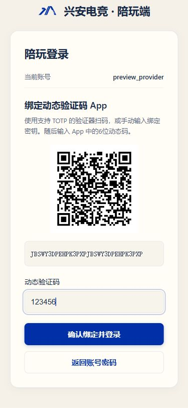

# OTP 登录布局修复（2026-10-06）

本次调整保留管理端 Element Plus 与陪玩端现有设计系统，修复绑定验证器、输入动态码和返回账号密码的布局。品牌蓝色、登录路由、账号字段顺序和恢复码保存流程沿用现有设计。设计取向为保留式调整，设计变化 2/10、动效 1/10、密度 5/10。

问题复核：管理端返回文字按钮紧贴验证码输入框，且小号控件规则覆盖登录页；陪玩端返回按钮使用默认 mini 控件。两端在绑定步骤保留禁用的账号密码字段，造成页面过长。

现在绑定步骤显示当前账号摘要、二维码、密钥和验证码输入，确认与返回分别占一整行。按钮与输入框为 44px，两个按钮间距 12px。手机陪玩绑定页使用紧凑页头，密钥可换行。返回后保留账号密码并清空当前验证码。陪玩端关闭加载层后再显示反馈，解决错误提示被隐藏的问题。

验证：
- 管理端 vue-tsc、陪玩端 TypeScript 检查通过。
- 管理端生产构建、陪玩 H5 与 weapp 构建通过；weapp 本次仅完成构建。
- 使用独立本地模拟 API，检查首次绑定、已绑定动态码/恢复码输入、返回后数据保留与验证码清空、错误提示、8 个恢复码展示。
- 浏览器检查 320px、375px 手机和 1280px 桌面布局，确认两端按钮同宽、44px 高；管理端 320px 下登录页不再出现横向滚动。
- 截图使用演示账号、演示 QR 和密钥。截图内容不包含真实账号的 OTP 绑定资料。

线上发布：`otp-layout-20261006T085156Z`，管理端与陪玩网页版共 177 个文件已通过公开 HTTPS SHA-256 核验；入口为 `index-DAX7UddX.js` 和 `app.e75011bf.js`。发布前备份位于 `/var/backups/xa/frontends/before-otp-layout-20261006T085156Z.tar.gz`。

