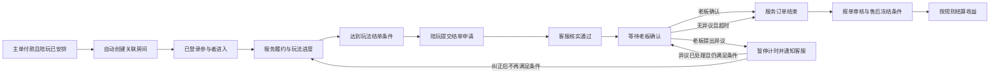

# 特殊玩法：三端订单房间

状态：**通用房间部分后端能力已开发，结单闭环及验收尚未完成**。用户明确要求借鉴既有 `play.xaesports.club` 的玩法交互，在本系统三端重新开发订单关联房间；**原游乐场的九种具体玩法本期先不覆盖**，以后按需开发。后续接入时以对应旧玩法的操作与核验流程为基础，并保留每家门店自己的规则；参考旧项目不等于直接迁移它的真实房间、账号或数据库。

## 1. 三方主线

| 阶段 | 老板端 | 陪玩端 | 本店后台／系统 |
| --- | --- | --- | --- |
| 支付及安排 | 完成特殊玩法主服务订单付款，查看陪玩安排。 | 接单或确认安排，查看本人资格及订单。 | 当原单已付款、所需陪玩均已安排到位，系统自动创建与订单关联的房间；双陪不能只安排一人就误认为全部到位。 |
| 进入房间 | 服务开始前即可从本人订单进入，查看本人有权查看的玩法和状态。 | 已安排陪玩以本人账号从订单进入。 | 每次校验已登录身份、所属门店、实际订单及参与关系；本店客服／售后按具体授权处理。创建失败应可追踪和安全重试，不能产生多个同一开房意图的有效房间。 |
| 履约及加购 | 查看进度和证据；服务进行中且符合玩法条件时可从原订单购买特殊加购。 | 按具体玩法规则提交本人有权操作的记录；查看与本人相关的加购及结果。 | 同步可授权看到的记录和状态；每笔加购单独核对付款及原单关联。旧玩法的具体角色、回合和核验规则仅在该玩法后续实际接入并经门店确认后生效。 |
| 具备结单条件 | 客服核实通过后，老板可确认，也可在房间或订单提出异议。 | 达到条件后提交结单申请，查看核实状态与本人结果。 | 客服核实通过后进入待老板确认，保存本店超时时长及其配置版本并计时。老板提出异议立即暂停自动确认，通知本店客服；异议处理完成且仍满足原结单条件时，从暂停时的剩余时间继续。 |
| 确认结束 | 老板主动确认；或等待期届满且没有异议时由系统自动确认。 | 查看原服务订单完成及后续本人报单状态。 | 原服务订单按正常状态流转结束并留存确认方式；报单审核、售后等待、收益冻结及入账仍分别执行，不能把房间可结单或订单完成直接显示成收益到账。 |
| 转单及售后 | 从原单查看房间、加购和售后；客服按售后逐项确定主服务与加购的退款范围。 | 原陪玩 A 转出后保留本人历史记录；新陪玩 B 按实际接入关系接替操作，查看其有权查看的信息。 | **保留原房间及进度**，转单成功时同步参与者和操作权限，原参与事实不抹除。B 按接入订单时本店配置形成本人抽成快照；其实际负责的后续加购沿用该快照。 |

已由客服核实、正在等待老板确认的房间订单若发生转单，原结单核实失效；接替陪玩需要重新提交结单申请，客服重新核实，通过后按当时门店配置启动新的确认时限。房间和既有履约记录继续保留。

进房、玩法内回合、服务订单开始和结束、报单审核、资金结算是不同事实。系统只按下单选择的预约时长报价，不因进房、离房或房间在线时间推导实际陪玩时长。订单尚未服务中时不得通过房间绕过已确认的加购限制。

异议处理后仍满足**原**结单条件时，图中回到待确认只恢复原剩余时长，不从头计时。若核验纠正后原条件不再满足，返回履约；再次满足条件时重新进入待确认，按**当时**门店配置保存新快照并开始完整时限。两次计时及异议均保留，不能将未完成的争议仅凭时间过去当作无异议。

确认时限已到但自动确认尚未完成时，老板仍可提出异议；异议先成功登记则暂停自动确认，若自动确认先完成则订单已结束。提出时剩余时间已为零的，客服处理后确认仍满足条件时恢复为立即到期，等待下一次自动确认。

房间存在未处理异议时，如果老板与所有受影响陪玩已确认整单协商终止方案，客服执行结案时同步关闭该异议并关联本次协商方案；实际退款和零退款均如此。异议、关联方案、客服经办人、确认计时作废和订单／资金处理须在同一事务内留痕，任一环节失败则一并回滚。若只终止部分陪玩、其余人员仍在履约，房间异议不因该部分结案自动关闭。

## 2. 身份、门店与权限

1. 房间归属原订单所属门店及其独立业务库。老板、陪玩、获授权门店人员及平台角色只能在各自授权范围内查看；同一个手机号、微信、房间号码或数字订单 ID 不构成跨店访问授权。域名、令牌、请求、实时连接、缓存、文件和异步任务均核对相同门店上下文。
2. 老板和陪玩使用三端已登录的账号进入，服务端根据订单付款、实际参与人和当前权限核验。链接或房间编号只用于定位，不能仅凭它占用老板／陪玩身份或读取房间；换设备重登后凭本人账号恢复，不依赖旧游乐场浏览器私存的匿名凭据。
3. 双陪分别关联两个本人身份；历史转出者仅按本人历史参与记录及授权查看，不能使用旧权限继续作为当前陪玩操作。改派失败不能先移除原人员或丢失进度，改派成功应原子地调整当前权限并保留审计。
4. 客服及售后以独立后台账号和授权进入或查看；订单负责人、咨询领取人和房间操作权限是不同关系，不能因客服名片、群消息或知道订单号就默认读取会话正文或获取全部房间操作权限。
5. 后续玩法若含老板私选信息、陪玩私有凭证或客服核验信息，接口、实时广播、日志、附件及导出均须按该玩法和角色授权过滤；不得把私有选择通过公共房间状态泄漏。老板在房间或订单提出异议属于反馈及客服处理入口，不应虚构已退款或已完成正式售后。

## 3. 进度、加购和结单

- 通用房间提供订单关联、参与者、状态、消息、异议、待确认、事件与审计、证据引用及玩法扩展接口；具体玩法需单独配置、开发并核验。本期不把旧站九套游戏的数据或页面伪装成已经实现，也不对尚未接入的玩法展示可正常玩的入口。
- 由于本期系统不能自动判断具体玩法目标和保底，达到条件后由本单当前陪玩提交结单申请，客服核实通过后交老板确认；无异议时按门店确认时限执行自动确认。客服核实本身不结束订单、不发放收益，也不替代老板确认。
- 每个房间保存订单及适用门店、玩法／套餐、具体规则和参数版本、参与者与每次接入、加购付款、进度事件、待处理事项及结单结果。状态刷新、多人并发、重复提交、请求结果不明、超时任务和转单／退款竞争时，须以服务端最新事实和幂等业务标识保证不重复开房、扣款或确认。
- 游戏内的任务进度、物资价值 `W`、局数、红格、骰子及卡牌是**玩法事实**；店币、人民币和会员积分是不同账户单位。不得将游戏内物资数值当成钱包资金、消费积分或真实货币收入。
- [特殊玩法加购](31-特殊玩法订单加购.md)只在原单服务进行中且该玩法条件满足时，从原单购买并以本店钱包按加购价付款；不使用折扣、优惠券或积分。玩法扩展如果需要为某一回合购买或选择选项，应保留付款与该回合的真实关联；付款失败不能赋予已购买权益，也不能以进度记录替代钱包流水。
- 加购跟随原单对应陪玩的抽成和收益归属、报单及等待条件结算；转单后由 B 实际负责的加购，使用 B **接入订单时**保存的抽成快照。主服务和各项加购的退款范围由售后逐项确定，各自关联原支付和履约结果。
- 老板确认或超时无异议的系统确认应与正常订单完成操作衔接；如果订单本身还有适用的履约凭证、人员和状态条件，不能仅靠前端房间按钮跳过。订单完成后，适用售后时钟、每位陪玩的有效报单和收益冻结按既定快照与条件执行，不串行重复等待或提前发放收益。

## 4. 旧游乐场代码：后续接入时的参考范围

已有项目位于 [兴安游乐场源码目录](C:/Users/chenh/Documents/ChatGPT/兴安电竞玩法/兴安游乐场-三玩法网页-20261027/OPERATIONS.md)。它使用独立 Node／SQLite 与 `rooms` 数据，客服手动开房，参与者使用房间号及独立凭据，**未接本系统门店账号、主订单、钱包及加购支付**；本轮只读取源码和公开页面，没有操作旧站房间、数据或部署。旧接口的 [room-api.ts](C:/Users/chenh/Documents/ChatGPT/兴安电竞玩法/兴安游乐场-三玩法网页-20261027/lib/room-api.ts)、[game.ts](C:/Users/chenh/Documents/ChatGPT/兴安电竞玩法/兴安游乐场-三玩法网页-20261027/lib/game.ts) 及 [room-engine.ts](C:/Users/chenh/Documents/ChatGPT/兴安电竞玩法/兴安游乐场-三玩法网页-20261027/lib/room-engine.ts) 是交互和状态依据，不可把旧匿名入座、价格或单库直接当作新多租户方案。

| 旧站玩法 | 原代码中需要理解的主要交互；均非本期具体玩法交付 |
| --- | --- |
| 飞行棋大作战 | 按成功撤离红格取得骰子；陪玩每次先选飞机，老板掷骰，所有飞机到终点后确认。旧规则区分特殊红物资及棋盘历史快照。 |
| 海克斯大乱斗 | 老板抽卡，陪玩按卡牌要求报战果；部分事件需客服核验，任务及保底共同决定是否可结单。 |
| 幸运骰子单 | 老板先掷横向列，陪玩或客服再掷纵向行，交点锁定保底；旧站当前规则为公平骰子，历史加权规则只用于相应旧快照。 |
| 黄金矿工常规版 | 根据成功撤离计金、红格及动态保底，不同套餐对采集过程的物资计入有不同条件。 |
| 拔萝卜 | 根据对局战果累计萝卜和怒气，并跟踪特殊例外与待完成事项；不以一个通用进度条代替各项条件。 |
| 童趣跳房子 | 按各格目标顺序推进，连续失败可能产生退格；不同格的门槛和证据不同。 |
| 环太平洋 | 跟踪不同出生点、成功条件、失败清除及保底；端游原有预言家／任意门对局前登记和锁定流程，旧站本身不收取对应加购款。 |
| 你的护不行 | 分狗牌、枪械、左轮三版，按各版计数或计分、失败追加与套餐规则计算。 |
| 黑洞遨游 | 老板私选黑洞，打手开始本局后锁定；由客服核验，其他参与者不能看到老板私选位置。 |

旧站服务端支持版本比较和操作编号，但当前 `seen` 只保留最近 100 项、对局历史只保留最近 100 项、公开日志只保留最近 400 项；新系统涉及订单、售后和资金时须以可追溯的正式业务事件及账务为准，不能把这些截断后的历史数组当作完整审计。旧站不自动读取官方游戏战绩，对局由参与者提交并按玩法核验；新系统不能伪造游戏数据接入。

## 5. 规则版本与产品范围

原站结构化目录 [`room-catalog.json`](C:/Users/chenh/Documents/ChatGPT/兴安电竞玩法/兴安游乐场-三玩法网页-20261027/lib/room-catalog.json) 是当时兴安房间的玩法快照，而不是两个门店目前统一价目。另有[2026-11-04 玩法项目协作记录](C:/Users/chenh/Documents/ChatGPT/兴安电竞玩法/AGENTS.md)：兴安黄金矿工常规版新增端游机密规则，但旧房间目录仅列既有 12 档；兴安黄金矿工**钓鱼版此前已暂时下架**，不能因旧附加项目仍在系统目录就自动恢复。声浪及其他玩法／平台不因兴安记录而自动变更。后续接入前须逐店核对对应玩法、价格、范围和上下架状态；已付订单的价格与已形成份额快照不被后续配置回写，转入陪玩的新份额按本人接入时配置另存快照。

通用房间本期可通过隔离测试门店及受控的测试玩法配置核验其真实身份、状态和账务衔接；不以九款旧游戏被复制上线为验收前提。将来某种玩法正式接入时，另按该玩法最新版、门店适用范围、角色、每局核验、结果权限、随机规则、异常及历史快照编写专门验收；无法核实的具体数值或上架状态不得猜测。

## 6. 关键验收场景

1. 单陪／双陪主单付款但人员未齐时不创建正式房间；全部安排后并发重试只产生一个有效关联房间。本人进入与跨店、无关老板、未参与陪玩的访问分别校验。
2. 服务开始前允许参与者进房，但不能因此自动将订单记为服务中或允许进行中专属加购；同一房间的任务进度和钱包资金分别显示。
3. 达到适用结单条件后，老板可确认；门店期限到达且无异议时系统可确认。提出异议并与超时并发时只能发生一个合法结果；异议未处理时不能自动结单。处理后条件仍成立则从原剩余时间继续；纠正后不满足而需继续履约，再次满足时按当时门店配置开启完整新时限。
4. A 转 B 成功后房间和历史进度不丢，B 获得当前操作权限，A 保留本人历史；B 接入时保存当时配置并用于 B 负责的加购。失败或冲突不能先剥夺 A 权限或重置进度。
5. 主单和多个加购存在不同退款范围时逐项处理并核对原付款、售后、收益及统计，不能因为房间已结束自动退款或二次扣款；历史进度与凭证继续可追溯。
6. 更改门店待确认时限仅影响之后进入待确认的房间；原等待保留进入时的配置版本及剩余时间。房间服务异常时不能伪造开房或结单成功，也不能重复释放收益。

以上是待执行的验收目标。旧站历史测试、公开页面可访问或本文件完成都不能当成本系统通用房间、真实订单和资金链通过的证据。
